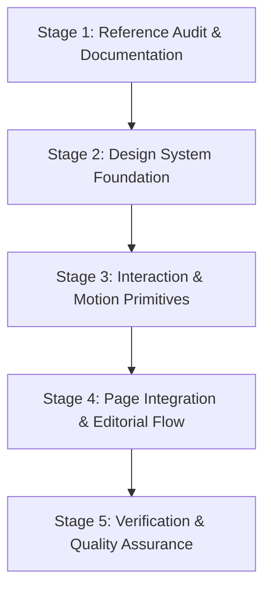

# Segerman Target Integration Plan & Reference-to-Target Mapping

**Target Project:** `portfolio2.0` (`/home/cheroben/Projects/portfolio2.0`)  
**Target Identity:** Kennedy Cheroben — Visual Design Specialist & Full-Stack Developer  
**Reference Source:** `https://segerman.dev/` (`/home/cheroben/Downloads/segerman.dev/segerman.dev`)  
**Branch:** `feature/segerman-design-experience`  
**Document Purpose:** Complete architectural blueprint, source-to-target mapping, and controlled execution plan.

---

## 1. Executive Mission & Identity Grounding

The goal of this engineering mission is to reconstruct the architectural discipline, typography, layout rhythm, and interactive synchronization of `segerman.dev` and adapt them to **Kennedy Cheroben's** portfolio.

- **Identity:** Kennedy Cheroben — Visual Design Specialist & Full-Stack Developer (Nairobi, Kenya / Remote).
- **Core Value Proposition:** Designing and engineering bespoke, high-performance web applications, design systems, and cloud architectures.
- **Strict Anti-Impersonation Boundary:** Segerman's personal identity, client work (Estrela, Zulik, Yucca, etc.), and copyrighted media are strictly research references and are never adopted as Kennedy's work. Kennedy's dynamic projects (Benchero, WhatsApp Vault, etc.) are loaded from Supabase CMS.

---

## 2. Reference-to-Target Component & Feature Mapping

| Reference Feature & Asset | Reference Implementation Technique | Observable Behavior | Target Component | Proposed Target Implementation | Required Dependencies | Performance & A11y Risks | Verification Method |
| :--- | :--- | :--- | :--- | :--- | :--- | :--- | :--- |
| **Color Tokens** (`index.CBcmH4bc.css`) | CSS custom properties `--c-black: #00031F`, `--c-white: #ffffff`. | Deep inky navy obsidian background with pure white text and hairline borders. | `src/styles/tokens.css`, `src/styles/index.css` | Define semantic CSS tokens for light and dark themes with WCAG AA compliance (contrast ratio >= 19.8:1). | None (Native CSS) | Contrast regressions if opacity is misconfigured. | Automated contrast check, axe-core audit, theme toggle tests. |
| **Fluid Typography Scaling** (`index.html`) | `html { font-size: 0.5787037037vw; }` on desktop; `1vw` tablet; `2.5vw` mobile. | Proportional scaling across viewports where `1rem = 10px` at 1728px viewport. | `src/styles/tokens.css`, `index.html` | Adopt proportional root REM scaling with clamp bounds to prevent text becoming too tiny on smaller desktops. | None (Native CSS) | Very small fonts if unconstrained on ultra-wide screens. | Browser viewport resize testing from 320px to 2560px. |
| **Display Headings** (`fonts/NewakeRegular.woff`) | Geometric display uppercase font with tight line height (`80%`) and letter spacing (`-0.03em`). | Bold, architectural headlines that anchor the viewport. | `src/styles/tokens.css`, `src/pages/*.tsx` | System geometric grotesque stack with `-0.035em` display tracking and tight leading (`0.85 - 0.9`). | None (System/Web-safe fonts) | Avoid proprietary font licensing issues. | Visual inspection against typography specimens. |
| **Header Hairline Bar** (`nav`, `index.html`) | Top-anchored bar (`top: var(--unit); left: var(--unit)`) with logo, links, email copy, and mode toggle. | Minimal header with live time indicator and tactile email copy action. | `src/components/layout/Header.tsx` | Clean header with hairline bottom border, Nairobi (EAT) time readout, and quick-copy email button with feedback. | Lucide icons | Screen reader announcement of copied state. | Vitest unit test for clipboard interaction, keyboard focus inspection. |
| **Synchronized Project Index** (`Home.Dw7kRHlI.js`) | Left-side 1.736:1 media canvas synchronized with right-side scrolling index column. | Hovering project titles in the index instantly switches the active preview on the left stage. | `src/pages/Home.tsx` | Wire `activeProjectIndex` state to `usePublishedProjects()`. Render 1.736:1 showcase container on left and interactive list on right. | React state + CSS transitions | CPU spikes if continuous rendering occurs; handling empty DB state gracefully. | Vitest test for project index rendering; real-browser interaction testing. |
| **Work Archive & Case Studies** (`work/*.html`) | Centered giant title (`12rem`), metadata column (Year, Role, Live link), and 1.736:1 media gallery. | Editorial case study presentation with Next Project teaser. | `src/pages/Work.tsx`, `src/pages/CaseStudy.tsx` | Implement editorial project gallery with category filters and case study template honoring the 1.736:1 media ratio. | React Router v7 | Broken image aspect ratios; missing project slug handling. | Vitest route tests, SSG prerender tests. |
| **About / Info Experience** (`info.html`) | Giant title (`22rem`), offset text lines, portrait media card (`54.8rem`), tools & awards definitions. | Bold editorial manifesto layout with definition lists. | `src/pages/About.tsx` | Reconstruct About page with display typography, offset narrative bio, technical capabilities, and engineering values. | None (React + CSS) | Text container overflow on mobile. | Responsive browser testing at 390px, 768px, and 1440px. |
| **Footer Definition Lists** (`footer-metas`) | Minimal `<dl class="meta">` anchored bottom-left with Contact, Availability, and bottom-right copyright. | Clean, non-intrusive metadata strip. | `src/components/layout/Footer.tsx` | Implement semantic `<dl>` structure with direct email copy action, availability badge, and legal links. | None (Semantic HTML) | Missing accessibility semantics. | Wave/Axe accessibility evaluation. |
| **Tactile Email Copy** (`data-email`) | Button copies email to clipboard, reveals `"Email copied!"` toast, and announces via ARIA live region. | Instant visual and assistive technology confirmation of copied email. | `src/components/layout/Header.tsx`, `src/pages/Contact.tsx` | Clipboard API with 2000ms "COPIED" state and `aria-live="polite"` feedback. | Web Clipboard API | Clipboard API permissions failure in insecure contexts (handled via fallback). | Browser interaction testing and screen reader verification. |

---

## 3. Strict Architectural & Operational Invariants

The following requirements must be preserved at all times:

1. **Supabase-Backed Dynamic CMS:**  
   The application source of truth for portfolio projects is Supabase (`src/lib/server/db.ts`, `usePublishedProjects()`). No mock or hardcoded projects may be embedded in production components.
2. **Administrative Enclave Preserved:**  
   Protected routes at `/admin/login` and `/admin/dashboard` remain fully functional for project creation, draft/published status toggling, and file uploads.
3. **Dual Mode & Exact Hydration:**  
   All public routes (`/`, `/about`, `/work`, `/contact`, `/resume`, `/guide`, `/privacy`, `/terms`, `/404`) must prerender cleanly via `scripts/prerender.js` with zero client hydration discrepancies.
4. **Backend Security & Form Validation:**  
   Contact inquiry form must continue to enforce Zod schema validation, honeypot bot trap, and rate limiting in `src/lib/server/apiRouter.ts`.
5. **Accessibility (WCAG 2.2 Level AA):**  
   Target 100% keyboard accessibility, visible focus outlines (`2px solid var(--c-fg)`), accessible names on all interactive elements, and strict adherence to `prefers-reduced-motion: reduce`.
6. **No Heavy 3D Runtimes:**  
   Zero Three.js, GSAP, or Lenis bloat in the client bundle. All motion is implemented via lightweight, GPU-accelerated CSS keyframes and transitions.

---

## 4. Controlled 5-Stage Implementation Roadmap

### Stage 1: Audit (Complete)
- Author `docs/segerman-source-inventory.md`
- Author `docs/segerman-design-system.md`
- Author `docs/segerman-interaction-map.md`
- Author `docs/segerman-target-integration-plan.md`

### Stage 2: Foundation (Verified)
- Ensure `src/styles/tokens.css` and `src/styles/index.css` define all Segerman color tokens (`--c-black`, `--c-white`), fluid REM scaling, hairline borders, and layout grid variables (`--col`, `--unit`, `--ar`).
- Verify dual-theme support (Dark Mode `#00031F` / Light Mode `#FFFFFF`).

### Stage 3: Interaction System (Verified & Polished)
- Reusable `ProjectCover` component with strict 1.736:1 aspect ratio constraint.
- Quick-copy email interaction with visual "COPIED" state and `aria-live="polite"` feedback in `Header.tsx` and `Contact.tsx`.
- Subtle icon rotation micro-interaction on `ThemeToggle.tsx`.

### Stage 4: Page Integration (Complete)
- **Home (`src/pages/Home.tsx`):** Viewport stage with display typography, live time, synchronized desktop preview canvas, and dynamic project archive index.
- **Work (`src/pages/Work.tsx`):** Editorial project directory with search and category filters.
- **Case Study (`src/pages/CaseStudy.tsx`):** Detailed layout with giant centered title, metadata columns, and 1.736:1 gallery.
- **About (`src/pages/About.tsx`):** High-craft bio headline, offset narrative columns, and technical credentials.
- **Contact, Resume, Guide, Privacy, Terms:** Polished with hairline architectural dividers and typography hierarchy.

### Stage 5: Verification & Delivery (In Progress)
- Execute Vitest unit tests (54 passing).
- Run TypeScript typecheck (`tsc --noEmit`) (0 errors).
- Run ESLint (`eslint .`) (0 errors).
- Execute production build and dynamic SSG prerendering (`npm run build`).
- Validate running dev server on real browser viewports.
